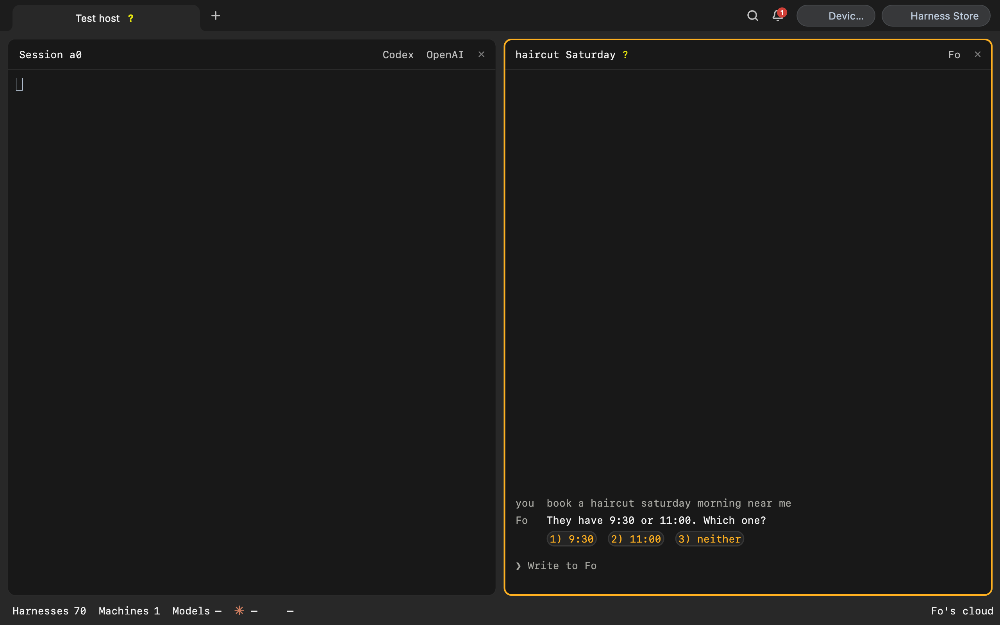
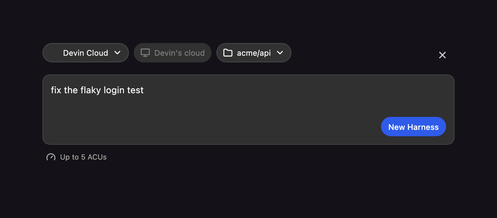

# Cloud agents

October 11, 2026. Approved. Replaces provider machines (`provider/`, `backend/src/lib/providerLink.ts`).

Some agents never run on your computer. Fo runs errands from its maker's servers: it calls, emails and
books. Devin Cloud and Cursor's cloud agents write code in their own cloud machines. None has a terminal program for Harness to start
in a pane; each has an API. This proposal makes them ordinary harnesses that **run in the cloud**. They
appear in the same lists, ask in the same Harnesses needing input, show on the Harness device, and are
started from New Harness. They are not a second product beside the panes.

## What a person sees

- **New Harness** offers the cloud agents in its Agent list beside the CLI agents: **Fo**, **Devin
  Cloud** and **Cursor Cloud**. A cloud agent's Computer selector reads its cloud (Fo's cloud, Devin's
  cloud) and cannot change.
- The harness opens a **chat pane** instead of a terminal: the conversation, a line saying what the agent
  is doing, and a prompt. Its header is every pane's header: the harness name and its activity mark on
  the left (`?` needs input, `⠹` working); the agent selector, the model selector only if the agent
  offers models (Fo does not), and × on the right. The place goes where a remote computer's name goes,
  in the footer's context for the focused pane, never in the header.

  ```
   auth-fix ⠹                             Claude Code  Opus 5.5  ×
  ────────────────────────────────────────────────────────────────
   (terminal)

   haircut Saturday ?                                        Fo  ×
  ────────────────────────────────────────────────────────────────
   you  book a haircut saturday morning near me
   Fo   Calling Hair Lab (0.4 mi)…
   Fo   They have 9:30 or 11:00. Which one?
        1) 9:30   2) 11:00   3) neither
   ❯ _
  ────────────────────────────────────────────────────────────────
                                                        Fo's cloud
  ```

  As built (rendered by `desktop/test/cloud_chat_pane_capture_test.dart` with
  `HARNESS_CLOUD_CAPTURE_DIR`), beside a terminal pane:

  

- **Devin and Devin Cloud** are two agents, as Cognition presents them; Cursor and Cursor Cloud the same.
  Devin is today's terminal pane on a computer. Devin Cloud asks for a GitHub repository Devin can reach
  rather than a folder (a local folder carries its GitHub remote over; its tooltip says uncommitted
  changes stay on the computer), and the session's ACU limit takes the place of Model, Approvals,
  Worktree and Branch:

  ```
   Devin Cloud   Devin's cloud   autonomous/api
   ┌───────────────────────────────────────────────────────────┐
   │ fix the flaky login test                                  │
   └───────────────────────────────────────────────────────────┘
   Up to 5 ACUs                                      New Harness
  ```

  As built:

  

  Its chat pane's footer carries the session's branch and pull request like any pane's:

  ```
   fix flaky login ⠹                              Devin Cloud  ×
  ──────────────────────────────────────────────────────────────
   you    fix the flaky login test
   Devin  Found a race in session refresh; fixing it.
   Devin  Opened #42. Tests pass.
   ❯ _
  ──────────────────────────────────────────────────────────────
                      Devin's cloud  api  (devin/fix-login)  #42
  ```

  Stop Harness puts the session to sleep, which stops its ACUs; opening it again from ⌘P wakes it.
  Cursor Cloud is the same form with Cursor's model selector in place of the ACU limit.
- When the agent waits for the person, the harness is in **Harnesses needing input** with its choices,
  on the desktop, the phone and the device's question screen, like any other harness.
- **Stop Harness** puts the agent's work to sleep where the agent allows it (Devin), and says so where it
  does not ("Fo keeps working on its own").
- Its conversation is found with ⌘P, and other harnesses can message it with `harness send` once Agent
  Messages is on for the tab.

## The name

Entered in the [Naming System](../naming-system.md):

| Term | Meaning | Example |
| --- | --- | --- |
| **Cloud** | An agent maker's own servers, as a place a harness runs beside the computers. A **cloud agent** runs there. | Devin Cloud runs in Devin's cloud; Fo runs only in Fo's cloud. |

How cloud agents are named: a CLI agent keeps its name, and the same maker's cloud coding agent is
that name plus **Cloud** (Codex and Codex Cloud, Cursor and Cursor Cloud, Devin and Devin Cloud). A
personal agent that has no CLI keeps its maker's name (Fo). Where a maker's personal agent shares its
CLI's name, the CLI takes its full product name: Meta's Muse agent would make today's Muse agent
**Muse Code**.

Nothing else is new. Fo and Devin Cloud are **agents** (the software chosen), a Fo conversation is **a
harness**, and the account that signs it in is a **connection**. Three words are avoided on purpose:
**machine** and **computer** mean the person's own computers (multi-machine, Connect a computer);
**remote** already means another of those computers in New Harness and `harness remote`; **provider**
already means model providers, sign-in providers and billing. "Cloud" appears nowhere in today's visible
copy.

## What exists, reviewed

The Provider Protocol (`provider/spec/README.md`) is a good shape: eight JSON-RPC methods over HTTPS,
one streamed turn, `turn_input_required` for a question, a conformance runner. It was last changed on
September 25 and nothing uses it.

- **No client can create or show one.** `POST /api/machines` accepts `providerUrl`, but no client sends
  it. The desktop and phone keep only remote machines (`desktop/lib/state/app_state.dart`,
  `mobile/lib/state/app_state.dart`); the React web app it was built for is retired. The Harness device
  lists them (`DeviceService.machinesForUser`), and only there.
- **Answering a question cannot work.** `runTurn` mints a new `turnId` for every message, so the
  `resume: true` answer can never name the paused turn, and no client sends `resume`.
  `turn_input_required` is forwarded as a plain final message, with no choices: it never reaches
  Harnesses needing input.
- **Attachments are never forwarded** (`backend/src/lib/provider/client.ts` sends `message.text` only).
- **It bypasses the daemon.** Everything a person sees about an agent today flows through the Harness
  daemon: the agent list, questions, ⌘P, Agent Messages, the device, the phone over the relay. A
  provider machine reaches none of it.
- **It is a machine.** Each provider is a row in `/api/machines` with its own $10 plan, beside the
  person's computers, on the same dial wheel.
- **Its tests do not run in CI.** The backend job runs `src/routes/desk.test.ts` only; `provider/e2e` is
  not in CI.

Vendors also do not speak it. Fo is reached through MCP tools, Devin through a REST API (and an MCP
server), and the industry's shared protocol for agents talking to agents is A2A (Linux Foundation, 150+
organizations). Its task states already include `working`, `input-required` and `completed`. We would
be asking every vendor to implement a fourth protocol that only we read.

## Design

### Where it runs: a daemon service

Cloud agents are a service of the Harness daemon, the `cloud` experiment: off by default, started on
first use, and stopping it stops nothing on the vendor's side. The service holds the adapters, signs in
through Connections, watches each open conversation and keeps a copy of its transcript under the data
folder for ⌘P.

The daemon, not the backend, because the daemon is where agents become visible to every client. The
cost: a cloud harness is listed under the computer that holds its connection, so it is out of reach
while that computer is off, though the agent keeps working in its cloud. Reaching it with no computer on
is a later step (webhooks to the backend, below).

### The one core change: agents a service owns

Today an agent is a registry row bound to a tmux pane (`RegisteredSession.tmuxPane` is required), and a
service has no way to add one. The core gains a small port so a service can own agents that have no
pane:

| The service | The core |
| --- | --- |
| publishes its agents and their state | merges them into `agents_list`, `agent_synced` and the fleet's list |
| posts and closes a question (text, up to six choices, free text allowed) | shows it wherever questions show, and routes the answer back to the service by question id instead of typing into a pane |
| receives deliveries | routes `turns.deliver` (⌘K, the phone's send, Agent Messages) for its agents to the service |
| receives Stop | routes Stop Harness for its agents to the service |

The frame gains `location: 'cloud'` and loses nothing: `terminal.available` is false, as for a stopped
agent today (`toStoppedProject`), and clients choose the chat pane by `location`. `deviceAgentListItem`
accepts cloud rows. The desktop already keeps a question's answer key apart from the pane "so a future
engine can key by an id" (`desktop/lib/state/pending_question.dart`). New requests join
`MACHINE_REQUESTS` so they stay end-to-end encrypted over the relay.

This is core code, and it is justified the way the core's rules ask: every client already treats agents
as one list, one question model and one Stop, and without the port each client would special-case cloud
harnesses forever.

### The adapter

Each cloud agent is one small adapter in the service. The service does the polling, the transcript
copy, the questions and the state. An adapter only translates.

```ts
interface CloudAgent {
  id: string                 // 'fo', 'devin-cloud', 'cursor-cloud'
  name: string               // the vendor's own name
  connection: string         // the Connections code that signs it in
  start(task: string, place: Place): Promise<Conversation>
  send(conversation: Conversation, text: string): Promise<void>        // a follow-up or an answer
  watch(conversation: Conversation, after?: Cursor): AsyncIterable<CloudEvent>
  history(conversation: Conversation, before?: Cursor): Promise<Page<CloudEvent>>
  list(): Promise<Conversation[]>                                       // for ⌘P and resume
  stop?(conversation: Conversation): Promise<void>                      // absent: it cannot be stopped
}

type CloudEvent =
  | { kind: 'message'; from: 'agent' | 'person'; text: string; at: string }
  | { kind: 'state'; state: 'working' | 'needs_input' | 'done' | 'failed' | 'stopped';
      question?: { text: string; choices?: string[] }; links?: { label: string; url: string }[] }
```

| | Fo (MCP, `mcp.api.wajo.ai/fo`) | Devin Cloud (REST v3, `api.devin.ai/v3`) | Cursor Cloud (REST v1, `api.cursor.com`) | Any A2A agent |
| --- | --- | --- | --- | --- |
| `start` | `ask_fo` in a new conversation | `POST /sessions` with the task as `prompt` | `POST /v1/agents` with `prompt.text` and `repos[].url` | `message/send` with a new `contextId` |
| `send` | `ask_fo` continuing it | `POST /sessions/{id}/messages` | `POST /v1/agents/{id}/runs` (`409 agent_busy` while a run is active) | `message/send` on the task |
| `watch` | `get_fo_reply` (waits up to 40 s a call) | `GET /sessions/{id}` every 10 s, then `/messages` | `GET /v1/agents/{id}/runs/{runId}/stream` (SSE, resumes with `Last-Event-ID`) | `message/stream`, or `tasks/get` |
| needs input | Fo's reply waits for the person | `running` + `waiting_for_user` or `waiting_for_approval` | a finished run is the agent's turn to wait | `input-required` |
| done | the reply closes | `running` + `finished`, or `exit`; `pull_requests` become links | run `FINISHED`; its `git` result becomes links | `completed` |
| `history` | `get_fo_conversation` | `GET /sessions/{id}/messages` | each run's `result`, from `GET /v1/agents/{id}/runs` | `tasks/get` history |
| `list` | `list_fo_conversations` (every channel: chat, email, texts, voice) | `GET /sessions` | `GET /v1/agents` | none |
| `stop` | none: Fo keeps working | archive, which puts it to sleep | cancel the active run | `tasks/cancel` |

`get_fo_reply`'s and `get_fo_conversation`'s parameters are not published; the first signed-in
`tools/list` fixes them. Cursor's v1 API is a public beta and has no conversation endpoint: the
transcript is the person's prompts and each run's streamed `assistant` text. Devin's MCP server (`mcp.devin.ai/mcp`, `devin_session_*`) is the alternative
to its REST API if one credential path for both matters more than REST's exact `status_detail`.

### Who else has a cloud agent

The pattern is common, in two kinds. **Cloud coding agents** are a maker's coding agent on its own
machine against a GitHub repository: Devin Cloud, Cursor's cloud agents, Codex cloud, Claude Code on the
web, GitHub's Copilot coding agent, Google's Jules. **Personal agents** run errands with their own cloud
computer and app connections: Fo, OpenAI's dots, xAI's Grok Bot, Meta's Muse. As of October 2026 Fo,
Devin and Cursor publish APIs that start and watch a session. Codex cloud is reached only through the
`codex cloud` command, and dots and Grok Bot publish no API yet. Each one that opens an API is one more
adapter.

### Credentials: Connections

A cloud agent signs in through a **connection**, so one sign-in serves both uses: Fo as an agent you
start, and Fo's tools inside Claude Code and Codex. The service calls the agent through the Connections
bridge (`127.0.0.1:51793`), which adds and renews the credential, and never reads `tokens.json`. Fo is an
MCP connection with sign-in today ("Add custom"). Devin's MCP server takes its key as a static header,
which "Add custom" also saves; a REST adapter needs a key-only connection that is not projected into
every agent's MCP configuration. `api_connections` is for model endpoints and is the wrong home.

### Clients

| Client | What it needs |
| --- | --- |
| Desktop | Cloud agents in New Harness and a chat pane. The pane reuses the ⌘P transcript preview (`widgets/session_tail_view.dart`), whose footer already takes a waiting question, plus a prompt. |
| Device | Cloud rows in its list. Questions use the existing question screen; nothing new in the firmware. |
| Phone | A chat page; it has no transcript view today. |
| TUI | A text view of the conversation in a pane. |
| ⌘P | A search source over the service's transcript copies. |
| Agent Messages | Delivery through the core port; a cloud agent sends with `harness send` once it has a sender identity that is not `$TMUX_PANE`. |

### Cost and safety

- No model runs on the computer. Watching costs only what the vendor charges.
- Devin bills while it works. New sessions get `max_acu_limit` (a setting, low by default), Stop puts the
  session to sleep, and closing an idle harness archives it.
- Fo acts in the world: it calls people and can pay. Its checks before hard-to-reverse actions arrive as
  questions and are never answered automatically. Agent Messages to a cloud agent stay off unless the tab
  turns them on.
- Watching backs off: every 10 s while a pane shows the harness, every minute otherwise, and stops after a
  day without change.

## The provider protocol

It is retired, not adapted. Vendors who want their agent in Harness implement A2A, and Harness ships an
A2A adapter. `provider/`, the backend's provider machines (`providerLink.ts`, `lib/provider/*`, the
provider plan in the seed, `authMode: 'provider'`) and the clients' leftover `provider` mode are deleted
in one change, once the A2A adapter exists. Nobody uses them, so nothing migrates.

## Phases

1. **Prototype**, in the `cloud` experiment: the core port, the service with the Fo, Devin Cloud and
   Cursor Cloud adapters, the desktop's New Harness and chat pane, and the device. Proven by an
   end-to-end run against a scripted fake MCP server and fake Devin and Cursor APIs, then one real Fo
   errand and one real session of each cloud coding agent with a low limit.
2. The phone's chat page, the TUI view, ⌘P and Agent Messages.
3. The A2A adapter, the provider protocol's removal, and webhooks: Fo's and Devin's notifications land on
   the backend, which wakes the computer's service, so a cloud harness can tell the person it needs them
   while no window is open.

## Decisions

Answered by the owner on October 11:

1. **Cloud agents**: "Cloud" is the place a harness runs, entered in the Naming System. Approved.
2. **The core change**: agents owned by a service. Approved.
3. **Retire the provider protocol for A2A.** Approved.
4. **A CLI agent and its maker's cloud agent are two agents**: Devin and Devin Cloud, Cursor and Cursor
   Cloud. CLI agents keep their names; the cloud agent adds "Cloud". Cursor Cloud is the third
   adapter, to prove one interface across three makers.
5. **The chat pane mockup.** Approved.
6. **Harness drives both kinds of agent**: terminal programs on the person's computers, and cloud
   agents through their makers' APIs. This replaces the October 5 rule that it drives only terminal
   programs.
